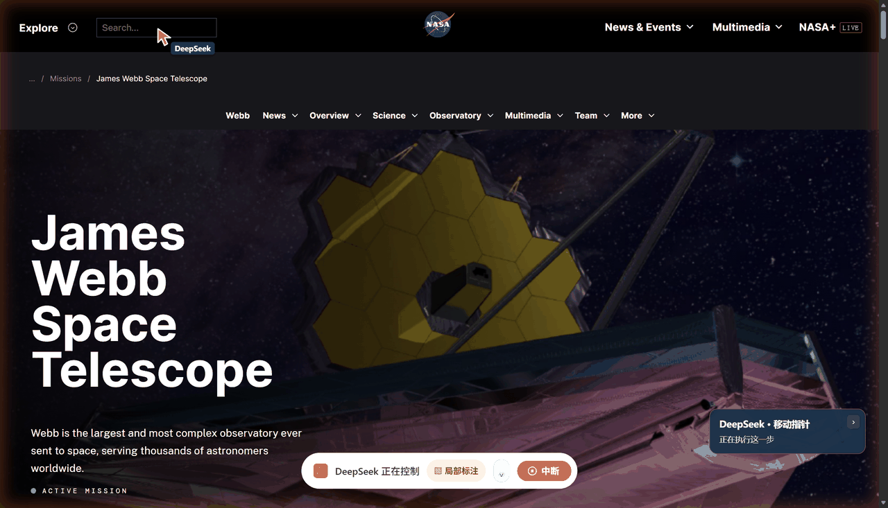
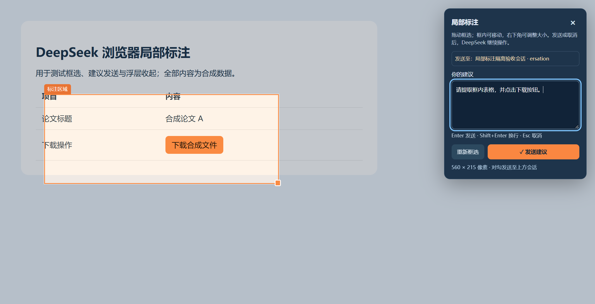

# DSH Edge Browser

Visible, background control of your everyday Edge browser for DeepSeek Harness.

[中文](README.md) · [Downloads](https://github.com/fengyuchang/dsh-edge-browser/releases/latest) · [Project site](https://fengyuchang.github.io/dsh-edge-browser/)

**Latest: 0.4.2-dsh.3, 2026-11-07.** Restores bottom-center controls and exclusive AI page control. Choose “用户插入” to pause AI and take over, then “完成并交还 AI” to return control. Login/help requests still unlock the page. Collapsing or hiding hints keeps input locked and leaves takeover available. Reload the Edge extension after current tasks finish. See the [changelog](docs/changelog.md).

Built on Tencent BrowserSkill 0.4.2. This community customization reuses the
browser's signed-in sessions, controls task tabs without moving the system mouse,
and shows what the agent is doing. It is not an official DeepSeek or Microsoft
extension and does not contain a private Codex browser implementation.

The experience target is Codex-style visible browser collaboration: observe the
agent's actions and take over when needed. This is a design goal, not a measured
claim of performance parity. This demo shows the yellow-orange edge glow,
DeepSeek pointer, curved comet trail and particles on NASA's actual page.



[Real-page demo, result screenshots and reproducible prompt](docs/browser-demo.md).
The GIF is a slowed replay of the shipped pointer component on the real page,
not a continuous screen recording. The guide also includes native-operation stills.



- Persistent cursor, curved gradient trail, particles, click rings and action status.
- Draw, move and resize a region; send its cropped screenshot and your suggestion.
- Destination pinned to the conversation owning the browser task, with a visible
  title and ID suffix. Switching chats never reroutes feedback. Missing, ambiguous
  or changed ownership fails without sending.
- Browser navigation, observation, listing and stopping stay within the caller's chat.
- Human takeover for sign-in or verification, then return control to the agent.
- Task-tab muting, native Edge debugger banner, tab groups and collapsible controls.
- Task completion releases debugger/control/effects. The model keeps useful result
  pages and unsaved forms and closes disposable created tabs. Borrowed originals
  return to their origin. Turn-end/cancellation cleanup conservatively keeps pages
  if the model omitted its decision, without touching other chats' tasks.

## Install

The complete offline package targets Windows x64. Install and initialize Edge
and a compatible DeepSeek Harness Desktop first, and configure a model.

1. Download and fully extract `dsh-edge-browser-windows-x64.zip` from Releases.
2. Quit Harness normally and run `一键安装.cmd`. The default destination is
   `D:\DeepSeek浏览器助手`; PowerShell options support other locations. Existing
   installations are not overwritten.
3. Open `edge://extensions`, enable Developer mode, and load the installed
   `extension` folder as an unpacked extension. Enable its local connection on
   port 52800.
4. Reopen Harness and use `/browser-skill` with the browser instance ID shown in
   your extension. Instance IDs are specific to each browser installation.

Only loading the extension does not install the Harness-side receiver. See the
[installation guide](docs/installation.md) for manual setup, custom paths and rollback.

## Annotation shortcuts

| Key | Action |
| --- | --- |
| Alt+Shift+A | Open annotation on the controlled task page |
| Enter | Send the suggestion |
| Shift+Enter | New line |
| Escape | Cancel and retain unsent text |

IME composition and key repeat do not accidentally send. The open shortcut is
configurable at `edge://extensions/shortcuts`. Create the browser task in its
owning chat and check the destination before submitting. An idle owner can receive
feedback; if that conversation is closed, reopen it in Harness first.

## Develop

Node.js 24+ is enough for `npm test`. To build the offline release on Windows x64:

```powershell
npm ci --ignore-scripts --legacy-peer-deps
npm run build:release -- --bsk 'path\to\BrowserSkill-0.4.2\bsk.exe'
```

The builder copies runtime dependencies and binaries, verifies the upstream
extension checksum, and produces checksummed ZIP assets under `dist/`. It never
reads personal Harness settings, conversation logs or browser profiles.

See [architecture](docs/architecture.md), [security boundaries](SECURITY.md) and
[third-party notices](THIRD_PARTY_NOTICES.md). MIT licensed; original Tencent and
dsh-doyourweb attribution is retained. The repo contains the complete customized
extension and patched native plugin distributions plus readable custom helpers;
upstream TypeScript/build sources remain available in Tencent/BrowserSkill.

## 0.4.2-dsh.1

CLI, extension and native plugin use protocol 1.8 together. Native step reduces action+sync round trips; bounded local IPC previews leave control overlays visible. Original-chat annotations, page-preserving finish, muted task tabs and the comet cursor remain. Tasks request no foreground focus and are minimized; deliberate human help can bring the task forward. See [upgrade evidence](docs/upgrade-0.4.2.md).
