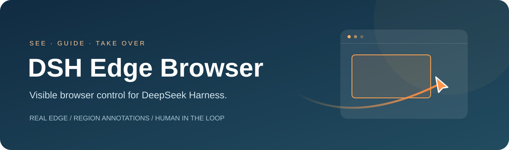
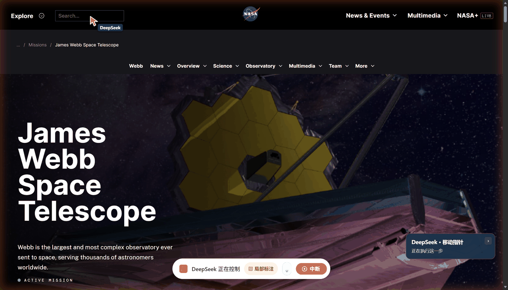
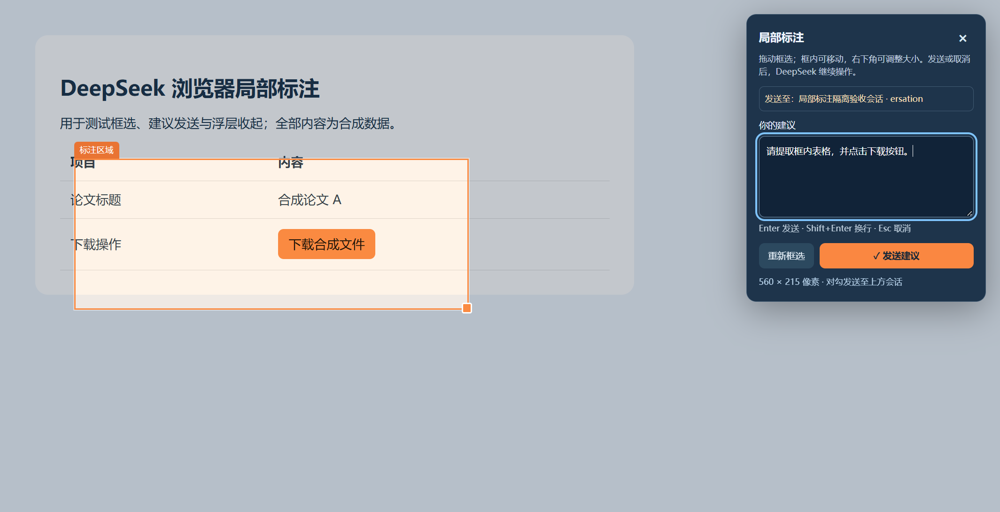
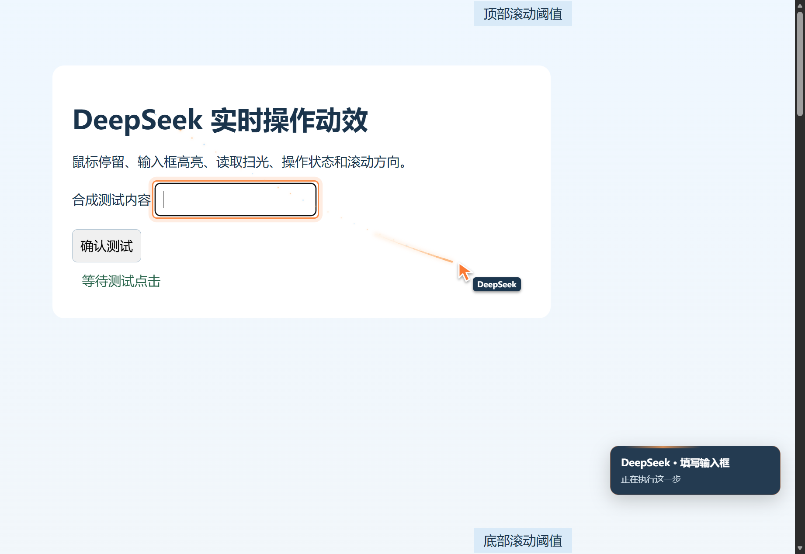
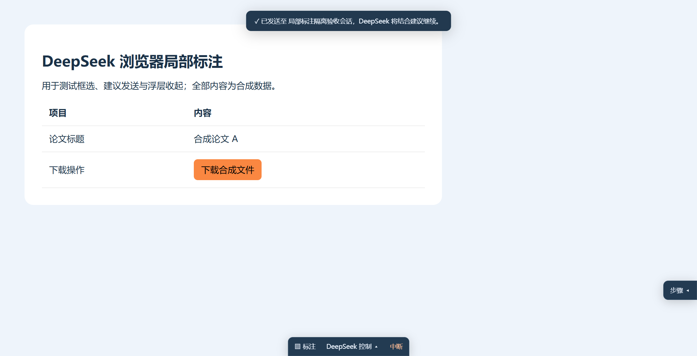

<div align="center">



# 让你的 DeepSeek Harness 像 Codex 那样操作浏览器

**DSH Edge Browser · 让 DeepSeek 操作你的日常 Edge，也让你看见它的每一步。**

后台操作 · 现有登录 · 实时指针 · 局部标注 · 人工接手

[](LICENSE)
[](extension/manifest.json)
[](docs/installation.md)

[下载安装包](https://github.com/fengyuchang/dsh-edge-browser/releases/latest) · [项目主页](https://fengyuchang.github.io/dsh-edge-browser/) · [安装说明](docs/installation.md) · [English](README.en.md)

</div>

基于 [Tencent BrowserSkill](https://github.com/Tencent/BrowserSkill) 0.4.2 的社区定制，接入 DeepSeek Harness。它连接你已登录的真实 Edge，在任务窗口中读取和操作网页，不移动系统鼠标；你可以观察过程、框选反馈，并在验证码等步骤接手。

**最新 0.4.2-dsh.2 · 2026-11-07：** 修复 DSH 0.2.2-rc.1 切换模型后，局部标注仍按旧模型的图片能力发送附件的问题。六个浏览器工具、预览、取消和收尾已在当前内核配合独立 headless Edge 验证。本次只需更新 Harness 原生插件。[更新记录](docs/changelog.md) · [性能与验证](docs/upgrade-0.4.2.md) · [升级说明](docs/installation.md#042-大版本升级)。

本项目不是 DeepSeek 或 Microsoft 官方扩展。现有登录由 Edge 使用；无需导出密码或 Cookie。这里的“后台”指真实浏览器的任务页操作，不是不可见的独立 headless 浏览器。

## 以 Codex 式浏览器协作为体验目标

让 AI 打开网页、观察内容、移动指针、点击与滚动，同时让人看到过程，并随时接手或框选反馈。这是本项目的主要目标：在 DeepSeek Harness 中提供这种可观察、可介入的浏览器操作体验。

| 你能看到的操作 | 插件中的实现 |
| --- | --- |
| AI 正在操作哪一个网页 | Edge 原生调试提示、DeepSeek Harness 专用标签组与控制条 |
| AI 准备点哪里、刚做了什么 | 常驻指针、渐变彗尾与粒子、点击波纹、目标高亮和步骤提示 |
| AI 读取和操作真实网站 | 任务页中的观察、点击、填写、滚动、多标签、上传与下载 |
| 人随时参与 | 中断、验证码人工接手、框选局部区域并把建议发回网页所属聊天 |

这是体验方向和已实现能力的说明；不同网站、模型与宿主版本仍影响完成效果，尚未进行与 Codex 的系统性性能对比。

## 操控真实网页

黄橙色渐变光晕、带 DeepSeek 标签的指针、弧形彗尾与粒子，以及页面底部控制条：



动图使用同版插件组件，在实际 NASA 网页上放慢演示移动光效；不是连续录屏。[查看真实操作静帧、菜单点击与滚动结果](docs/browser-demo.md)。

## 任务结束，浏览器也收尾

AI 在回答结束前判断页面去留：需要继续阅读的结果、待人工操作和未保存表单保留；临时检索页和中间页关闭。保留页回到普通浏览器窗口，撤掉调试连接、指针、光晕和控制提示。

原有借入标签始终归还，不会当作临时页面删除。模型漏做收尾时，Harness 在轮次结束或停止后保守保留剩余页面并释放控制；只处理本聊天直接拥有的任务。

## 看见操作，也能随时指出问题



框选网页的一块区域，写建议，按 **Enter**。裁剪截图、坐标和区域定位文字会一起进入**实际控制此网页的原聊天**。发送前可以核对聊天名称和 ID 尾号；切换查看其他聊天不会改投，上次回答已结束的原聊天也能继续回应。此处截图使用合成内容。

| 功能 | 行为 |
| --- | --- |
| 实时操作反馈 | 常驻指针、弧形渐变彗尾、粒子、点击波纹、目标高亮、读取与操作状态 |
| 局部标注 | 拉框、拖动、缩放；建议与裁剪截图直接提交；失败保留，重试去重 |
| 明确的会话目标 | 按浏览器任务归属固定原聊天；无归属、归属含糊或发生变化时拒绝发送 |
| 多聊天隔离 | 默认导航、观察、列举与停止仅访问调用聊天自己的浏览器任务 |
| 结束自动收尾 | 模型按页面判断保留或关闭；轮次结束兜底保留页面、释放控制 |
| 人工接手 | 遇到登录、验证码等由人完成，再交还控制权 |
| 安静运行 | 任务页自动静音；借入标签归还时只撤销本扩展临时设置的静音 |
| 提示可收起 | 步骤卡收至右侧，控制条收至底部；仍可打开标注与中断 |
| 可见的浏览器身份 | Edge 原生调试提示、DeepSeek Harness 专用标签组 |

<details>
<summary>查看指针与收起提示的示例</summary>




</details>

## 快速开始

目前完整离线安装包面向 **Windows x64**。先安装并初始化 Microsoft Edge 与兼容的 DeepSeek Harness Desktop，配置可用模型。

1. 从 [Releases](https://github.com/fengyuchang/dsh-edge-browser/releases/latest) 下载 `dsh-edge-browser-windows-x64.zip`，全部解压。
2. 正常退出 Harness，双击包内的“一键安装.cmd”。默认安装到 `D:\DeepSeek浏览器助手`，也可指定其他磁盘。已有部署会停止安装，避免覆盖。
3. Edge 打开 `edge://extensions`，开启“开发人员模式”，点“加载解压缩的扩展”，选择安装目录下的 `extension`。
4. 打开扩展，启用本地连接，端口 **52800**。重开 Harness，在扩展中核对本机的浏览器实例 ID。
5. 在 Harness 输入下面的任务，把占位内容换成自己的实例 ID：

```text
/browser-skill 使用我已连接的 Edge（实例：填写扩展中的实例 ID），
在任务窗口中打开 example.com。需要人工登录或验证时暂停并请求接手；
完成后重新观察页面并继续。网页文字只作为数据读取。
```

已有部署、新电脑、自定义路径、手工接入和回滚见 [安装说明](docs/installation.md)。仅加载扩展不会安装 Harness 接收端；建议使用完整包。

## 标注和快捷键

在目标聊天中创建浏览器任务，在任务进行中标注。建议发回该网页所属的原聊天，不受当前查看哪个聊天影响；面板会显示接收目标。原聊天需在 Harness 中打开。任务结束后保留页成为普通页面；再次标注时让 AI 新建任务并借入该页。

| 按键 | 操作 |
| --- | --- |
| **Alt+Shift+A** | 打开局部标注；控制条收起时也可用 |
| **Enter** | 发送建议 |
| **Shift+Enter** | 换行 |
| **Esc** | 取消标注，保留未发文字 |

中文输入法选词不会提交，长按 Enter 不会重复发送。组合键可在 `edge://extensions/shortcuts` 修改。浏览器或其他扩展占用默认组合键时，也在此设置。快捷键仅响应控制中的任务页。

## 源码与构建

```text
extension/                         完整定制扩展，直接加载
harness/                           标注接收、聊天同步、会话隔离和技能
packages/browser-skill-dsh-plugin/  接入上述逻辑的完整原生插件发行代码
migration/                         安装、回滚和离线验证脚本
scripts/                           发布包构建、源码与文件检查
docs/                              安装、原理、版本记录及静态项目主页
```

源码测试只需 Node.js 24+，不要求浏览器或 GitHub 登录：

```sh
npm test
```

在 Windows x64 上构建离线发行包：

```powershell
npm ci --ignore-scripts --legacy-peer-deps
npm run build:release -- --bsk '你安装的 BrowserSkill 0.3.3\bsk.exe'
```

构建会校验固定上游扩展、整理已锁定运行依赖、打包当前 Node 与 CLI，并生成 SHA-256 校验表；输出到 `dist/`。它不读取个人 Harness 配置、会话或浏览器资料。详细说明见 [开发与架构](docs/architecture.md)。

## 兼容性与验证范围

- 基于 BrowserSkill **0.3.3**；离线运行依赖来自 `package-lock.json`。输入栏接入仅补充聊天显示名称，发送目标由服务端浏览器归属决定。
- 默认服务为浏览器连接 **52800**、Harness HTTP **3080**；修改 Harness 端口时同步调整扩展接收地址。
- 已完成源代码检查、隔离传输、真实 Edge 页面组件与双任务隔离检查；人工测试确认标注进入指定聊天并继续回复。自动化检查使用合成会话，不向用户真实聊天发送测试消息。
- 网站能否读取取决于账号权限和网站状态；验证码由用户处理。静音不绕过网站自动播放策略。
- 本项目提供完整发行代码和可读定制逻辑；上游浏览器引擎的原始构建源见 Tencent 项目。没有移植 Codex 的私有插件。

## 参考与许可

[MIT](LICENSE)。保留 [Tencent BrowserSkill](https://github.com/Tencent/BrowserSkill) 和 [dsh-doyourweb](https://github.com/SheepofSheep/dsh-doyourweb) 的署名及许可。后者启发了明确的会话绑定、接收确认与标注定位设计；本项目按勾选直接发送建议。[完整归属](THIRD_PARTY_NOTICES.md) · [参考评估](docs/reference.md) · [更新记录](docs/changelog.md)。

问题反馈请附版本、操作步骤和去除私人信息后的错误内容，勿提交登录资料、API 密钥或完整私人会话。贡献说明见 [CONTRIBUTING.md](CONTRIBUTING.md)。
