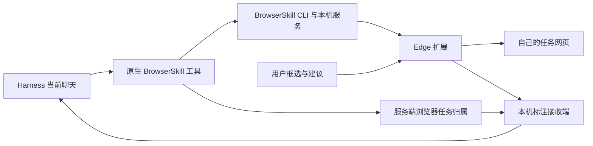

# 代码结构与验证



`extension/background.js` 保留上游会话与权限校验。定制接入点保留原生归属、页面和合作控制校验；`source/extension/dsh-task-groups.js` 管理任务分组和临时静音，`source/extension/dsh-visual-activity.js` 与 `source/extension/dsh-pointer-relay.js` 根据真实命令转发状态和位置。可视化不依赖系统鼠标。

`content-scripts/dsh-controls.js` 使用封闭 Shadow DOM 显示标注编辑器与边缘控件。标注截图时暂时隐藏浮层；画框、拖动和缩放均在冻结画面中进行。截图最长边限制为 1600 像素，文字不超过 4000 字。建议发送前固定目标，只有收到接收回执才显示成功。

`harness/dsh-annotation-client.js` 接入已有的 `conversation.input.overlay`，只提供匹配 ID 的聊天显示名称；它不决定发送目标。接收端从原生注册表解析网页所属的唯一桌面聊天，忽略当前选中的其他聊天。

`harness/dsh-annotations.mjs` 注册本机路由，验证扩展来源、任务归属、范围与 PNG；在编辑开始和附件保存后两次检查归属。标注使用 `browserskill-annotation` 来源，工具可用性通知使用上游 `plugin:@wxg-prc-cpg/browser-skill-dsh-plugin` 来源，均符合当前 v4 消息格式；图片模型接收图片，文字模型接收 PNG 文件和区域文字。接收后调用既有 agent 输入机制，使已结束一轮回答的聊天也可以继续。

`harness/dsh-session-scope.mjs` 统一约束工具调用。默认会话号只能解析到调用聊天自己的浏览器；列举、显式访问与停止同样校验归属，保留停止回执恢复。

## 开发约定

`harness/dsh-task-finish.mjs` 提供 `bsk_session(action=finish, keepTabIds)` 和完成钩子。模型决定保留的任务页，经标签归还接口转移成普通页面，再停止任务窗口；其他任务创建页关闭，借入的原有标签按上游流程归还。扩展 `dsh-task-finish.js` 在原生权限校验后扩展 `tab_return`，保留同一个标签及未保存状态，并释放 CDP、重置浮层与临时静音。转移失败不执行停止，保留部分回执以便重试。

`agent/turn-stopping` 在正常结束前兜底；`agent/status=idle` 覆盖取消与错误结束。两者只清理直接拥有者的浏览器，不处理仍在工作的子 Agent 或其他聊天。兜底保留所有页面，避免在没有模型判断时丢失未保存数据；旧 idle 事件遇到新轮次会跳过。

- `harness/` 是可读定制 helper，`packages/browser-skill-dsh-plugin/lib/` 为已接入的完整插件。源码检查保证两份 helper 和内置技能相同。
- `extension/` 包含可直接加载的完整发行代码；上游打包文件保留原样结构，定制逻辑集中在可读脚本。上游完整 TypeScript 编译工具链见 Tencent/BrowserSkill。
- `scripts/build-release.mjs` 仅从仓库、已安装锁定依赖、显式 CLI 文件与当前 Node 构建离线包。依赖的许可证随包保留，并写入清单。
- 私人 Harness 配置、账号、会话日志、Cookie 不参与公开构建。

## 检查

`npm test` 不安装运行依赖、不启动真实浏览器、不向真实聊天发消息，检查语法、分组、静音、命令挂钩、指针生命周期、边缘滚动、标注传输、标题同步、原聊天路由、来源与会话隔离。

真实 Edge 界面组件检查需要显式实例：

```powershell
$env:BSK_PATH = 'E:\tools\bsk.exe'
node annotation-ui-check.mjs --browser YOUR_INSTANCE_ID
```

它只创建自己的合成网页和任务窗口，模拟扩展传输，建议送入隔离接收会话。真实双窗口隔离检查为 `annotation-scope-live-check.mjs`，需先安装 npm 依赖。两者都在结束时清理自己的任务窗口。

`node task-finish-live-check.mjs --browser YOUR_INSTANCE_ID` 使用真实原生工具和隔离的合成聊天检查保留结果、未保存表单、关闭中间页及完成钩子。测试页通过自身的本机测试指令关闭；不会向真实聊天发送消息。`task-finish-check.mjs` 覆盖转移失败重试、外来标签拒绝和父子聊天隔离。

已完成的人工验收还确认正确聊天收到建议并继续回应；这些结果不意味着任意未来 Harness 版本都兼容。更换宿主、API 或上游版本后应重新验证。

## 0.4.2 源码构建与预览

`source/upstream.json` 固定上游提交；`source/browser-skill.patch` 保存原生接入点改动。`scripts/build-source.mjs` 应用补丁并复制可读适配器，通过 WXT/tsdown 构建，不修改压缩 bundle。`source-build.json` 记录输入与关键产物 SHA-256；源码变化后必须重建。

模型工具继续使用上游 CLI/队列/权限模型。只有给人看的预览使用 `harness/dsh-preview.mjs` 的受限本地 IPC：先校验协议与本地管道，限于显式 `dsh_preview` 截图，按会话取消、限时限长并校验响应。它复用原生归属/文档身份检查，不隐藏控制浮层；模型截图保持原来的干净截图路径。鼠标视觉消息异步转发，合并连续移动，不合并按下/释放；视觉消息失败不阻塞原生命令。
