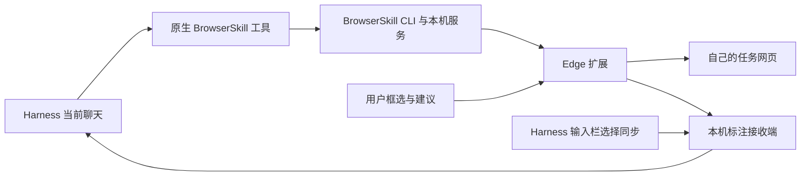

# 代码结构与验证



`extension/background.js` 保留上游会话与权限校验。定制接入点在其校验通过后执行；`dsh-task-groups.js` 管理任务分组和临时静音，`dsh-visual-activity.js` 与 `dsh-pointer-relay.js` 根据真实命令转发状态和位置。可视化不依赖系统鼠标。

`content-scripts/dsh-controls.js` 使用封闭 Shadow DOM 显示标注编辑器与边缘控件。标注截图时暂时隐藏浮层；画框、拖动和缩放均在冻结画面中进行。截图最长边限制为 1600 像素，文字不超过 4000 字。建议发送前固定目标，只有收到接收回执才显示成功。

`harness/dsh-annotation-client.js` 接入已有的 `conversation.input.overlay`，发布选中聊天并保持序号递增。焦点移至 Edge 后不丢失选择；多个不同选择不猜测目标。

`harness/dsh-annotations.mjs` 注册本机路由，验证扩展来源、选择、范围与 PNG。新消息采用 `browserskill-annotation` 来源；图片模型接收图片，文字模型接收 PNG 文件和区域文字。接收后调用既有 agent 输入机制，使已结束一轮回答的聊天也可以继续。

`harness/dsh-session-scope.mjs` 统一约束工具调用。默认会话号只能解析到调用聊天自己的浏览器；列举、显式访问与停止同样校验归属，保留停止回执恢复。

## 开发约定

- `harness/` 是可读定制 helper，`packages/browser-skill-dsh-plugin/lib/` 为已接入的完整插件。源码检查保证两份 helper 和内置技能相同。
- `extension/` 包含可直接加载的完整发行代码；上游打包文件保留原样结构，定制逻辑集中在可读脚本。上游完整 TypeScript 编译工具链见 Tencent/BrowserSkill。
- `scripts/build-release.mjs` 仅从仓库、已安装锁定依赖、显式 CLI 文件与当前 Node 构建离线包。依赖的许可证随包保留，并写入清单。
- 私人 Harness 配置、账号、会话日志、Cookie 不参与公开构建。

## 检查

`npm test` 不安装运行依赖、不启动真实浏览器、不向真实聊天发消息，检查语法、分组、静音、命令挂钩、指针生命周期、边缘滚动、标注传输、选择同步、来源与会话隔离。

真实 Edge 界面组件检查需要显式实例：

```powershell
$env:BSK_PATH = 'E:\tools\bsk.exe'
node annotation-ui-check.mjs --browser YOUR_INSTANCE_ID
```

它只创建自己的合成网页和任务窗口，模拟扩展传输，建议送入隔离接收会话。真实双窗口隔离检查为 `annotation-scope-live-check.mjs`，需先安装 npm 依赖。两者都在结束时清理自己的任务窗口。

已完成的人工验收还确认正确聊天收到建议并继续回应；这些结果不意味着任意未来 Harness 版本都兼容。更换宿主、API 或上游版本后应重新验证。
