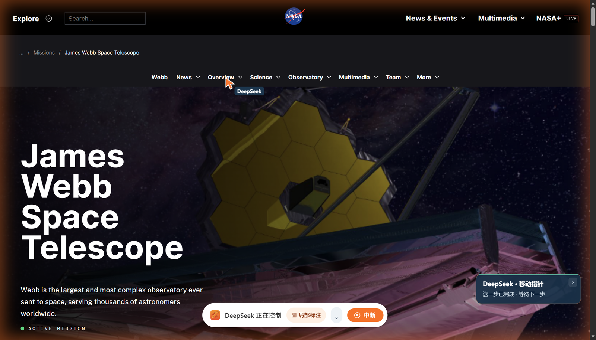
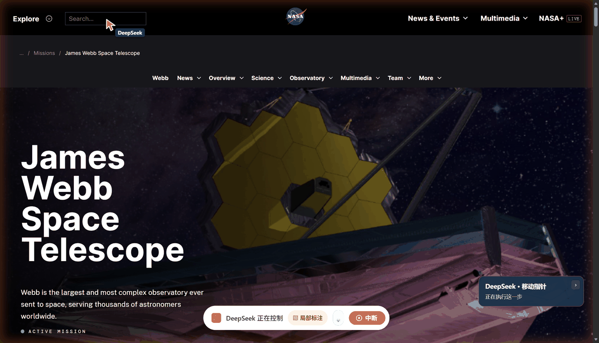
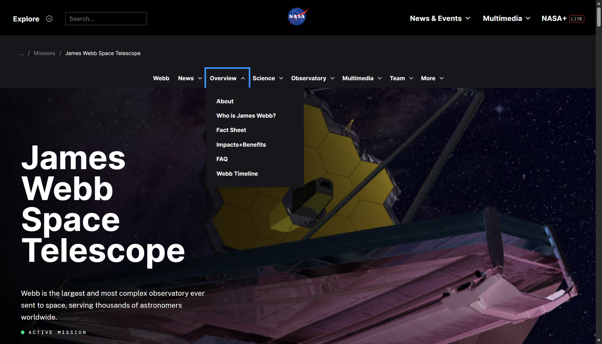
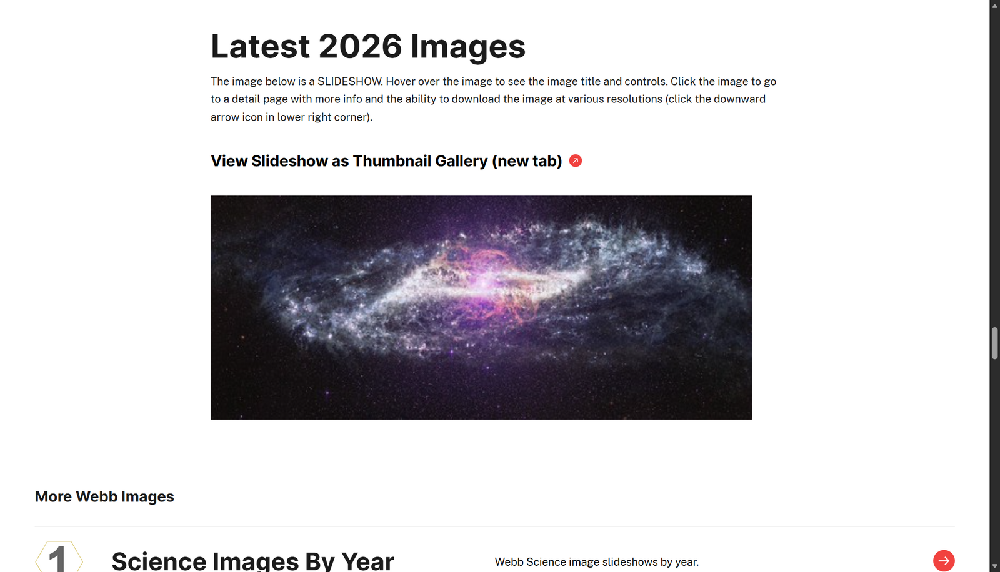
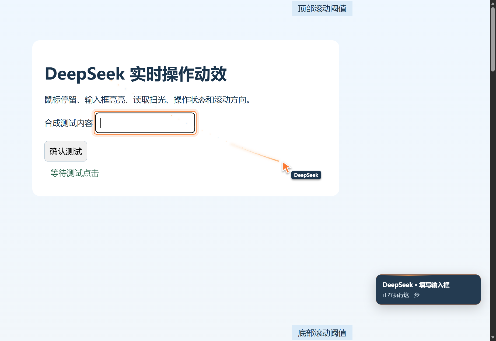
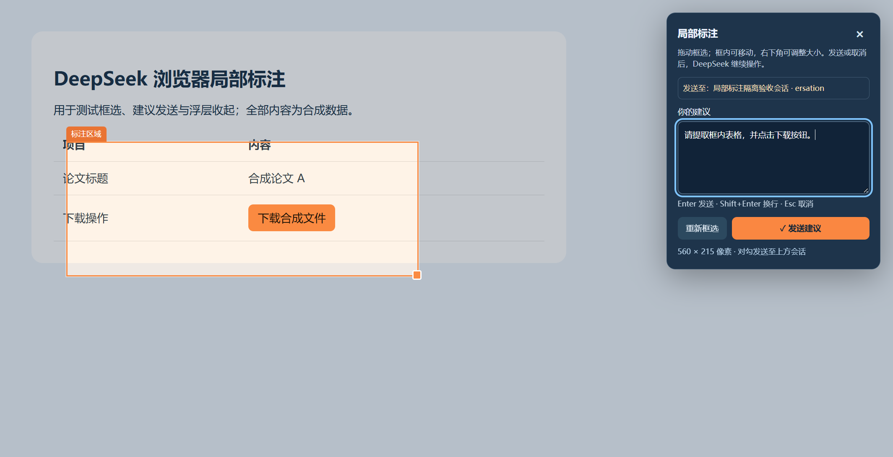

# 真实网页操作展示

本项目以 **Codex 式的可观察、可接手浏览器协作** 为体验目标：AI 在真实浏览器任务页工作，人能看见操作并随时介入。公开截图来自本项目的 Edge 扩展与原生 Harness 插件，网站选用无需登录的 NASA 公共页面。

## 真实网页：NASA Webb 任务页



这一帧来自原生浏览器工具真实移动指针后的页面：周围是黄橙色控制光晕，Overview 处是 DeepSeek 指针，下方为控制条与当前步骤。



动图在同一 NASA 页面上运行同版指针组件，按实际目标位置重放并放慢动画，展示弧形渐变彗尾、透明度衰减与粒子。只为逐帧检查开放了组件的 Shadow DOM；未重绘网页或更改动效样式。它是组件演示，不是连续操作录屏。

2026-11-01 使用原生 `bsk_session`、`bsk_page`、`bsk_inspect` 与 `bsk_interact` 在独立 Edge 任务窗口执行：打开页面、观察控件、移动到目标、展开 Overview 菜单、点击 Latest Images、滚动页面。每个操作都作用于同一个新建演示任务，演示结束后只关闭这个任务。

页面：[James Webb Space Telescope — NASA Science](https://science.nasa.gov/mission/webb/)。





这两张是实际网页操作后的静态关键帧。常规网页截图接口会隐藏控制浮层并清掉移动拖尾；上方指针静帧在演示页临时恢复浮层可见性后拍摄。展示内容不含账号或私人聊天。

## 指针、状态与人工反馈





这两张使用合成测试内容，展示实际插件组件。界面会显示常驻指针、渐变轨迹、粒子、点击波纹和步骤状态；标注可拖动、缩放，Enter 确认后回到网页所属的原聊天。原生 Edge 调试提示与专用标签组出现在浏览器顶部，不属于网页截图范围。

## 自己演示一次

在 Harness 中输入，把实例 ID 换成扩展弹窗中的值：

```text
/browser-skill 使用已连接的 Edge，实例为“你的实例 ID”。
在新任务窗口打开 https://science.nasa.gov/mission/webb/，
观察页面，展开 Overview 菜单，再查看 Latest Images 并向下滚动。
每步确认页面结果，操作过程中供我观察和局部标注。
任务结束保留结果页供我阅读，关闭无用的中间页，并结束浏览器控制。
```

操作期间打开任务窗口，即可看见指针与提示。点“局部标注”或按 Alt+Shift+A，拉框并填写建议，核对“发送至”的 ID 后按 Enter。建议会发回创建这个浏览器任务的聊天，切换查看其他聊天不改变收件人。

任务完成后，模型列出自己的标签并调用 `bsk_session` 的 `finish`，用 `keepTabIds` 选择需要留下的页面。保留页成为普通标签，控制提示与动效停止；借用的个人标签归还。遗漏显式收尾时，轮次结束钩子保守保留所有剩余页面并解除控制。以后要标注保留页，重新创建浏览器任务并借入它。

“对标”描述体验目标，不代表复用了 Codex 私有源码，也不代表已完成跨网站、跨模型的系统性效果评测。

网页内容和图片归原网站及其标注权利人所有，截图用于说明浏览器交互；本项目 MIT 许可不重新授权这些第三方素材。
